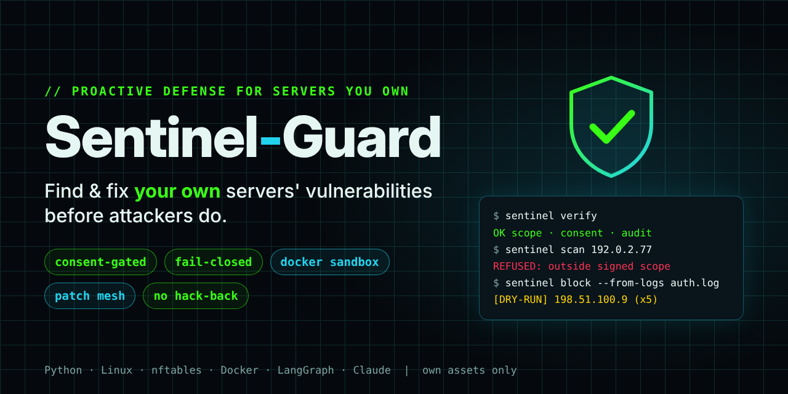
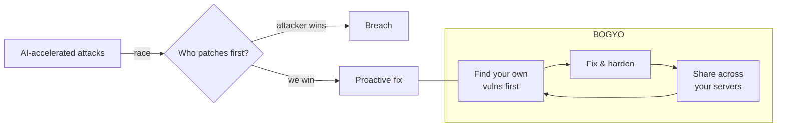
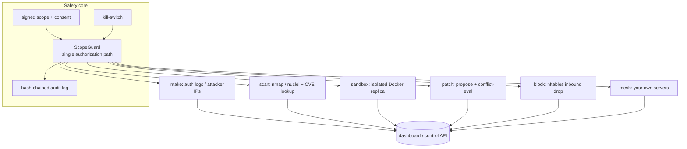
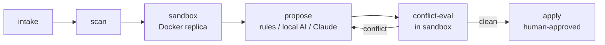

# BOGYO

[](https://github.com/Hirasawakazumaz/BOGYO/actions/workflows/ci.yml)
[](pyproject.toml)
[](LICENSE)
[](tests/)
[](docs/SAFE_USE.md)



**Proactive, consent-gated defense for Linux servers you own.**
Find and fix your own vulnerabilities before attackers do — and let your own servers
harden each other — all behind a single authorization gate that **fails closed**.

> ⚠️ **For assets you own or are explicitly authorized (in writing) to test — nothing else.**
> BOGYO refuses any target outside your signed ownership scope. It never attacks third
> parties and never "hacks back". Read the [Terms of Use](TERMS_OF_USE.md),
> [Disclaimer](DISCLAIMER.md), [Safe-Use Request](docs/SAFE_USE.md) and
> [legal notes](docs/legal.md) before use.

*The name:* **bōgyo** is the Japanese word for *defense* — the opposite of attack, not a
counter-attack. That is the design in one word: **get there first, hold your own ground,
and never strike back.**

---

## The idea at a glance

AI is accelerating attacks: intrusion tooling now iterates faster than people can patch.
BOGYO does not answer with offense. It **out-paces attackers on its own ground**:

| | Principle | What BOGYO does |
|---|---|---|
| 1 | **Find first** | Continuously checks *your own* servers, confirms findings in an isolated sandbox, and fixes them before an attacker gets there. |
| 2 | **Link your own machines** | Runs on several servers you own; each specializes in a patch domain (e.g. `sshd`, `nginx`), so patches are produced in parallel. |
| 3 | **Strengthen by a signed chain** | Servers share patches over a rolling-key channel and a signed, hash-linked patch chain; each applies a peer's patch **only after its own sandbox conflict check passes**. |

**Never, by design:** hack-back, attacking systems you do not own, new exploit development,
generic attack payloads, or detection evasion.



## How it works

Every active capability is routed through **one guard** (`ScopeGuard`) that refuses to act
unless a signed ownership scope and your signed consent are present, the kill-switch is
clear, the capability is enabled, and the target is in scope. Every allow/deny is written
to a tamper-evident audit log.



**The patch pipeline.** A patch reaches a real host only after it passes a conflict check
in the sandbox **and** an explicit human approval — never automatically on production.



**The own-server mesh.** Each node holds a machine-bound, passphrase-encrypted key (not a
copyable API key). Pairs talk over a channel whose key **changes with every message**
(derived from the previous ciphertext and the time window), doubly encrypted and signed.
Shared patches live on a signed, hash-linked chain. A received patch stays `shared` until
the local sandbox checks have actually run and passed; in dry-run, without checks, or on
any refusal it is **never** applied. Details: [docs/WHITEPAPER.md](docs/WHITEPAPER.md) §4
and [docs/MESH_SETUP.md](docs/MESH_SETUP.md).

## Safety model

1. **Signed ownership scope** — list the hosts/CIDRs you own in `config/scope.yaml` and sign
   it (Ed25519). Anything outside it is refused; editing the file breaks the signature
   until re-signed.
2. **Operator consent** — a signed consent record bound to the scope hash. Changing the
   scope forces re-consent (`sentinel consent`).
3. **Default-deny** — every active capability (`blocking`, `active_scan`,
   `sandbox_redteam`, `patch_apply`) is **off** by default, and `dry_run` is **on**.
4. **Sandbox-only attack validation** — permitted only against an isolated replica
   (`environment=sandbox`) and **hard-refused** on production. Isolation is enforced by
   structural analysis of the compose file (internal-only networks; no docker socket, host
   binds, added capabilities, devices, host namespaces, privileged mode or published ports).
5. **No hack-back** — defense is limited to dropping inbound traffic (`nftables`).
6. **Tamper-evident audit log** — every allow/deny and action is hash-chained
   (`sentinel verify`).
7. **Kill-switch** — a single file stops everything (`sentinel kill`).

There is intentionally **no flag or environment variable that disables the guard**.

## Quick start

```bash
python3 -m venv .venv && . .venv/bin/activate
pip install -e ".[dev]"        # extras: ".[tui]" dashboard, ".[agent]" LangGraph/LLM

cp config/scope.example.yaml config/scope.yaml
cp config/settings.example.yaml config/settings.yaml
# edit config/scope.yaml so it lists ONLY assets you own
sentinel init                  # create config/ + state/, consent keypair (alias: bogyo)
sentinel keygen                # scope signing keypair
sentinel sign-scope            # sign scope.yaml
sentinel consent               # read and accept the clauses, sign consent
sentinel status                # review mode / toggles / scope / consent / audit
```

Everything runs in **dry-run** until you set `dry_run: false` *and* the specific toggle in
`config/settings.yaml` — review the dry-run output first.

```bash
# block attackers found in an auth log (needs toggles.enable_blocking)
sentinel block --from-logs /var/log/auth.log --threshold 5

# scan an in-scope host (needs toggles.enable_active_scan)
sentinel scan 203.0.113.10 --tool nmap

# replay a finding in an isolated Docker sandbox (needs enable_sandbox_redteam; never production).
# Each --validate command must run INSIDE the sandbox (bound to its network/project):
sentinel sandbox --replica 10.0.0.5 --compose docker/sandbox.example.compose.yaml \
  --validate "nuclei=docker compose -p sentinel_sbx_10_0_0_5 exec -T web nuclei -u http://localhost"

# propose hardening as a unified diff (apply needs enable_patch_apply + --approve)
sentinel patch --service sshd --config /etc/ssh/sshd_config

# periodic runs: prints a systemd timer + cron fallback (never installs them)
sentinel schedule --command "block --from-logs /var/log/auth.log" --on-calendar daily

# report, usage governor, dashboard
sentinel report --md run.md --json run.json
sentinel usage                 # daily token budget -> model downgrade / throttle / stop
sentinel dashboard --once      # plain-text snapshot; `sentinel dashboard` for the TUI

# own-server mesh (see docs/MESH_SETUP.md)
sentinel mesh keygen --name serverA
sentinel mesh serve --replica <sandbox-host> --compose <replica-compose-file>
```

## What is implemented

Safety core (scope / consent / audit / kill-switch / guard) · defensive IP blocking · scan
orchestration and passive CVE lookup · Docker sandbox replay · patch generation with a
sandbox conflict-evaluation loop · rule-based hardening for sshd, nginx, postgres and
sysctl · own-server patch mesh with a sandbox conflict gate · LangGraph orchestration
(optional) · systemd/cron scheduling · audit-log run reports · Claude usage governor ·
dashboard (Textual TUI + plain snapshot) and a JSON control API · 115 tests, CI on
Python 3.11–3.13.

## Documentation

- 📄 **[docs/WHITEPAPER.md](docs/WHITEPAPER.md)** — philosophy, architecture, patch
  pipeline, the own-server mesh, and threat model, with diagrams.
- 📚 **[docs/publication/](docs/publication/README.md)** — illustrated concept &
  architecture, usage guide, paper draft, safe-use requests, disclaimer.
- [docs/MESH_SETUP.md](docs/MESH_SETUP.md) · [docs/architecture.md](docs/architecture.md) ·
  [docs/threat-model.md](docs/threat-model.md) · [CHANGELOG.md](CHANGELOG.md)

## Responsible use, disclaimer and legal notes

By using BOGYO you accept the [Terms of Use](TERMS_OF_USE.md) and the
[Disclaimer](DISCLAIMER.md). In short:

- **Authorized use only.** Only systems you own or are authorized in writing to test.
- **No warranty, no liability.** Provided "AS IS"; the authors and contributors are not
  liable for any damage or legal consequence arising from use or misuse.
- **You are responsible for compliance** with applicable law — including Japan's
  Unauthorized Computer Access Act and Penal Code Arts. 168-2/168-3 and 234-2, the US CFAA,
  the UK Computer Misuse Act, Germany's StGB §202c and the Budapest Convention — and with
  your contracts, hosting-provider terms and organizational policies.
- **Not legal or security advice.** The documentation describes the engineering; consult
  qualified professionals for your situation.
- **Automated actions.** With capabilities enabled and dry-run off, BOGYO can change
  firewall rules and configuration files on a schedule. Review, approve, keep backups, and
  test in a safe environment first.
- **Cryptography.** The mesh channel and machine-bound key are a pragmatic design on
  standard primitives, not a formally verified protocol and not hardware key protection.
- **Third-party tools and services** (nmap, nuclei, OWASP ZAP, trivy, Docker, LLM
  providers) are governed by their own licenses and terms. The optional geo lookup (off by
  default) sends attacker IPs to `ip-api.com` over plain HTTP; its free tier is for
  non-commercial use only.
- **Please do not** point it at anyone else's systems, run attack validation against
  production, or remove/weaken the safeguards — and do not redistribute a build that does.
  Report vulnerabilities as described in [SECURITY.md](SECURITY.md).

## License

[MIT](LICENSE) with an additional use notice (authorized, defensive use only).
BOGYO was previously named *Sentinel-Guard*: the Python package (`sentinel`) and the
CLI command (`sentinel`, alias `bogyo`) keep the old name for compatibility.
