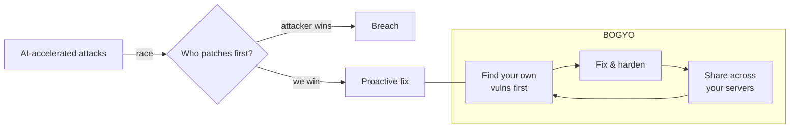
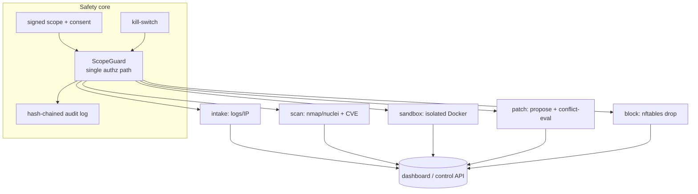
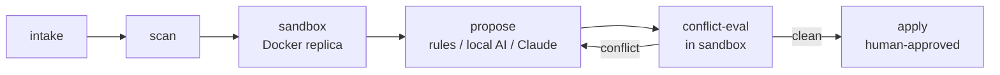
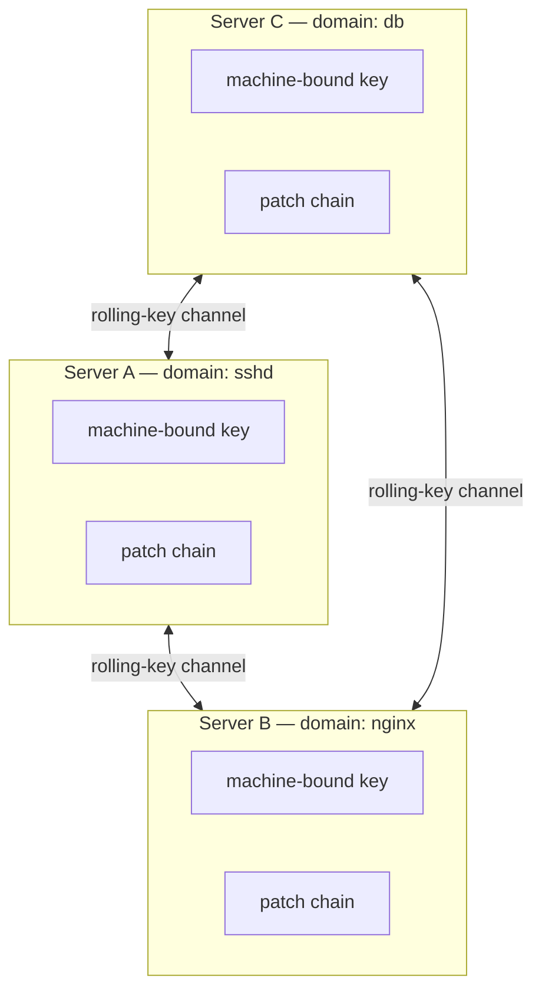
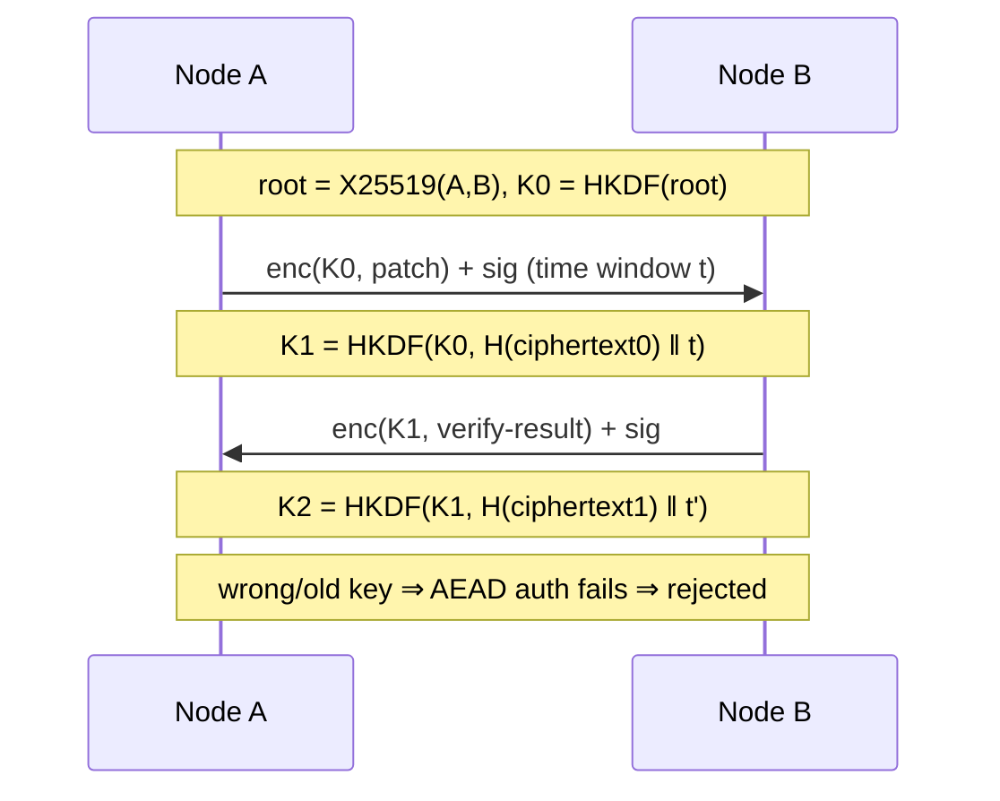
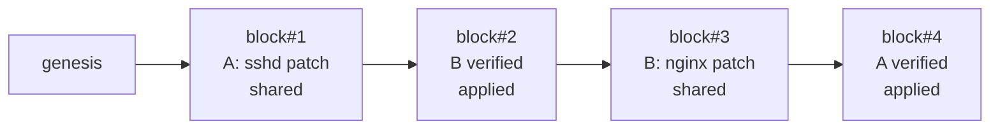

# BOGYO — Whitepaper

*Proactive, consent-gated, distributed defense for servers you own.*

> This document explains the philosophy, architecture, and safety model. It is an
> engineering design paper, **not** legal advice, and the software is for use on
> the operator's own, authorized assets only.

---

## 1. Philosophy

Modern attacks are increasingly **AI-accelerated**: malware and intrusion tooling
iterate faster than human defenders can patch. The response this project takes is
not to attack back, but to **out-pace attackers on our own ground**:

1. **Find first** — continuously discover *your own* server's
   vulnerabilities before an attacker does, and fix them.
2. **Link many machines** — run the same software on several servers
   you own, each specializing in a different patch domain, working in parallel.
3. **Strengthen by blockchain composition** — the servers
   share their patches over a private, signed chain and only apply a peer's patch
   after verifying it causes no conflict, so the fleet hardens itself cooperatively.



**Non-goals:** no hack-back, no attacking systems you do not own,
no new exploit development, no detection evasion. These are excluded by design.

---

## 2. System architecture

Every active capability is routed through a single, bypass-proof **guard** that
fails closed unless a signed ownership scope and operator consent are present.



- **Default-deny + dry-run**: every capability is off by default; nothing executes
  until the operator enables it and turns off dry-run.
- **Sandbox-only attack validation**: exploit *validation* runs only inside an
  isolated Docker replica whose compose file is structurally checked for isolation
  (internal-only networks; no docker-socket/host mounts, caps, host namespaces).

---

## 3. Patch-creation pipeline



A patch is only applied to a real host after it passes the conflict check in the
sandbox **and** an explicit human approval; never automatically on production.

---

## 4. Distributed parallel-patch mesh

Servers the operator owns form a private mesh. Each node specializes in a patch
domain (e.g. one does `sshd`, another `nginx`), so patches are produced in
parallel, then shared and cross-verified before being applied.



### 4.1 Authentication & the rolling-key channel

- **Identity, not an API key**: each node holds an Ed25519+X25519 key stored in a
  **machine-bound, passphrase-encrypted file** (scrypt over passphrase + machine
  fingerprint). Copying the file to another machine fails to decrypt — it is not a
  portable, copyable secret. (True hardware non-extraction needs a TPM/HSM; this is
  machine+passphrase binding, documented as such.)
- **Rolling key**: a pair derives a shared root via X25519. The session key then
  **changes on every message**, derived from the hash of the previously exchanged
  ciphertext *and* the current time window. A peer is accepted **only** if its
  message authenticates under the expected key; after processing, both sides
  ratchet forward. Messages are encrypted in **two AEAD layers** and signed.



### 4.2 Blockchain of patches

Each shared or applied patch is a **signed block** linked by hash to the previous
one. The chain gives a tamper-evident, ordered, cross-signed record of what every
node proposed and what was verified and applied.



A peer's patch is applied **only after the local conflict check passes** — the same
sandbox conflict-evaluation used for local patches — so a bad patch from one node
cannot break another.

---

## 5. Threat model & safety

| Risk | Mitigation |
|---|---|
| Pointing the tool at systems you don't own | Signed ownership scope; guard refuses out-of-scope targets (fail closed) |
| Accidental production attack | Red-team is sandbox-only, hard-refused on production; dry-run default |
| Silent scope/consent/audit tampering | Ed25519 signatures; consent bound to scope hash; hash-chained audit |
| Runaway automation / cost | Rate/target/time limits; usage governor (budget → model downgrade → stop) |
| Forked build with safeguards removed | Single guard path, no disable flag; terms forbid it; safeguards covered by tests |
| Mesh misuse against third parties | Consent clause: own servers only; machine-bound keys; peers are operator-listed |
| Compromised peer sends a bad patch | Signatures + conflict-eval gate before apply |

See also [legal.md](legal.md), [threat-model.md](threat-model.md),
[SAFE_USE.md](SAFE_USE.md), and [../DISCLAIMER.md](../DISCLAIMER.md).

---

## 6. Using it (summary)

```
sentinel init           # scaffold config/state, consent keypair
# edit config/scope.yaml  → your OWN hosts/CIDRs only
sentinel keygen         # scope signing keypair
sentinel sign-scope     # sign the scope
sentinel consent        # read & accept the clauses (own-assets-only, mesh rule)
sentinel status         # review mode / toggles / scope / consent / audit
sentinel dashboard      # live ops screen (pipeline, sandbox, blocks, usage)
sentinel mesh keygen    # (optional) machine-bound node key for the server mesh
```

Full guidance: [../README.md](../README.md) and the in-dashboard help (`h`).
