# BOGYO: Concept and Architecture, Illustrated

**Preparing for AI-accelerated attacks with "get there first", "defense in depth" and "records that cannot be silently rewritten"**

> Every capability in this document is labelled:
> **[Implemented]** code and tests exist / **[Proposal — not implemented]** design only, no code yet

---

## Contents

1. [Background: AI is making attacks faster](#1-background-ai-is-making-attacks-faster)
2. [The defense philosophy: three pillars](#2-the-defense-philosophy-three-pillars)
3. [Design principles: fail closed](#3-design-principles-fail-closed)
4. [System overview](#4-system-overview)
5. [Chain of trust: signed scope, consent, guard](#5-chain-of-trust-signed-scope-consent-guard)
6. [ScopeGuard decision flow](#6-scopeguard-decision-flow)
7. [Tamper-evident audit log (hash chain)](#7-tamper-evident-audit-log-hash-chain-implemented)
8. [Reproduction in an isolated sandbox](#8-reproduction-in-an-isolated-sandbox-implemented)
9. [Patch proposal and conflict-evaluation loop](#9-patch-proposal-and-conflict-evaluation-loop-implemented)
10. [Defensive blocking (no hack-back)](#10-defensive-blocking-no-hack-back-implemented)
11. [AI usage governor](#11-ai-usage-governor-implemented)
12. [Dashboard and control API](#12-dashboard-and-control-api-implemented)
13. [Multi-PC cooperation and composite chain "BOGYO Mesh" (proposal)](#13-multi-pc-cooperation-and-composite-chain-sentinel-mesh-proposal)
14. [Defense in depth, summarized](#14-defense-in-depth-summarized)
15. [Glossary](#15-glossary)

---

## 1. Background: AI is making attacks faster

Generative AI automates and accelerates much of an attacker's work, for example:

- reading a published vulnerability advisory and prototyping an exploit,
- running reconnaissance at scale (enumerating exposed services, hunting for misconfigurations),
- mutating malware into variants that slip past signature detection,
- writing phishing messages tailored to a target.

As a result, **the time between a vulnerability being published and it being exploited** is shrinking.
If defenders rely on monthly manual checks or react only after an incident report, attackers find the hole first.

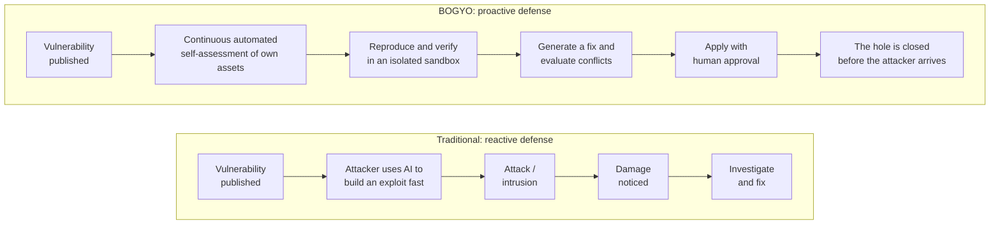

*Figure 1: Reactive vs. proactive defense. The proactive approach aims to find and close the hole yourself before an attacker does.*

The key tension is this: **defenders must automate or they lose on speed**, yet **automated tools can themselves become dangerous**.
Scanning and attack-validation tools turn into attacks on someone else's systems if pointed at the wrong target.
BOGYO is built to satisfy both requirements at once: move fast, and never point at the wrong target.

---

## 2. The defense philosophy: three pillars

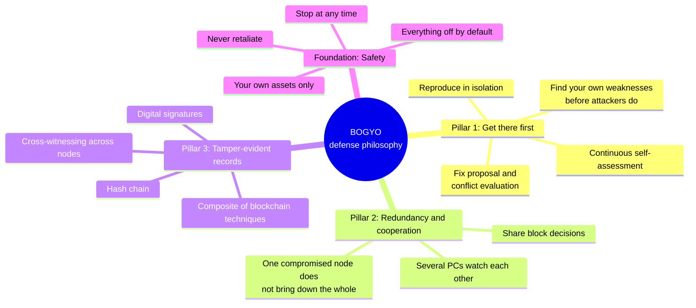

*Figure 2: The defense philosophy. Three pillars stand on a foundation of safety.*

### Pillar 1: Get there first (proactive defense) [Implemented]

**Find the vulnerabilities in your own servers before attackers do, and defend them.** This is the core idea.

If attackers use AI to probe, defenders should probe themselves just as often — but **only their own assets**. BOGYO runs this loop:

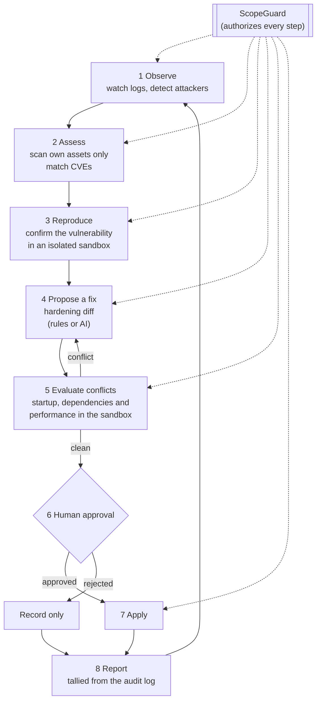

*Figure 3: The proactive defense loop. Every step passes through ScopeGuard; applying a fix always requires a human.*

### Pillar 2: Redundancy and cooperation (linking multiple PCs) [Proposal — not implemented]

If one server defends itself and is then compromised, both its defenses and its records are lost together.
The idea is therefore to **link several PCs/servers that you own so they watch each other**:

- when one node detects an attacker, it informs the others **with a signature**;
- the others verify the signature and their own authorization before blocking (they never accept automatically);
- nodes attest each other's audit-log head hashes, so **rewriting the records on one machine is noticed by the others**.

See [Section 13](#13-multi-pc-cooperation-and-composite-chain-sentinel-mesh-proposal) for details.

### Pillar 3: Tamper-evident records (a composite of blockchain techniques) [Partly implemented]

One of the first things an intruder does is **erase their tracks** (delete or alter logs).
BOGYO protects its records by **combining the building blocks of blockchains to fit the purpose**:

| Technique | Role | Status |
|-----------|------|--------|
| Hash chain | Removing or editing even one entry breaks the chain and is detected | [Implemented] |
| Ed25519 signatures | Prove the scope and the consent were made by the operator | [Implemented] |
| Canonical hashing (canonical JSON + SHA-256) | The same content always yields the same hash | [Implemented] |
| Merkle trees | Summarize many records into one value; prove inclusion of a single record | [Proposal] |
| Cross-witnessing across nodes (k-of-n signatures) | Keep records correct even if a node is compromised | [Proposal] |
| Optional anchoring to an external timestamp (RFC 3161, etc.) | A third party proves the records existed at that time | [Proposal] |

> **Why not use a cryptocurrency-style blockchain as-is?**
> The things being protected are a handful to a few dozen machines that you own. Every participant is you,
> so consensus by massive computation (Proof of Work) is unnecessary and wastes power and time.
> A ledger with a fixed membership (permissioned) combined with multi-signature agreement is the rational choice.

---

## 3. Design principles: fail closed

An automated defense tool must **fall to the "do nothing" side when configuration is broken or information is missing**.
This is called **fail-closed**. BOGYO follows seven principles:

| # | Principle | Mechanism | Status |
|---|-----------|-----------|--------|
| P1 | Your own assets only | Any target not in the signed scope (`config/scope.yaml`) is refused | [Implemented] |
| P2 | Explicit consent | Signed consent bound to the scope hash; changing the scope requires re-consent | [Implemented] |
| P3 | Everything off by default | Blocking, scanning, attack validation and patch apply are disabled by default; `dry_run` is on by default | [Implemented] |
| P4 | Attack validation only in isolation | Attack validation against a production-flagged target or outside a sandbox is refused regardless of settings | [Implemented] |
| P5 | Never retaliate | Defense is limited to dropping inbound traffic; nothing is sent back to the attacker | [Implemented] |
| P6 | Record everything | Every allow and every deny is written to the hash-chained audit log | [Implemented] |
| P7 | Stop at any time | A single file (the kill-switch) stops everything | [Implemented] |

In addition, **there is deliberately no flag or environment variable that disables the guard.**
Removing it requires editing the source code, which the [Terms of Use](../../TERMS_OF_USE.md) prohibit.

---

## 4. System overview

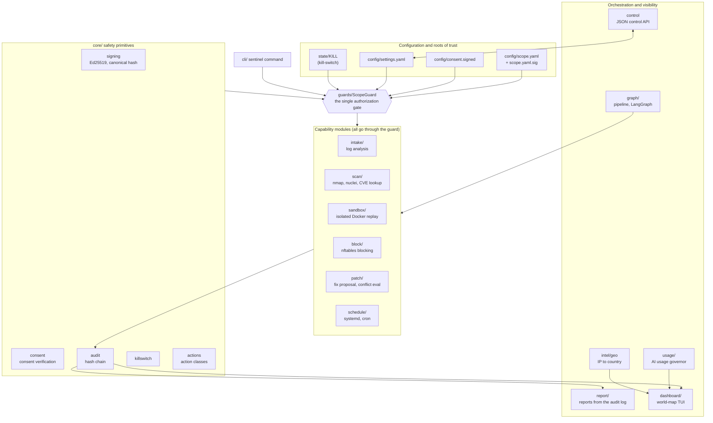

*Figure 4: System overview. Capability modules always pass ScopeGuard before acting, and their results are written to the audit log. Reports and the dashboard only read the audit log.*

### Modules [all Implemented]

| Directory | Role | Effect outside the process |
|-----------|------|----------------------------|
| `core/` | Signing, consent, audit, kill-switch, action classes | None |
| `guards/` | `ScopeGuard`, the single authorization gate | None |
| `intake/` | Extracts attacker IPs from failed-auth logs (no network access) | None |
| `block/` | Adds time-limited blocks to an nftables dynamic set | Your own firewall |
| `scan/` | Active scanning with nmap/nuclei; CVE lookup via OSV | Your own assets |
| `sandbox/` | Reproduction and validation in an isolated Docker Compose environment | Isolated containers only |
| `patch/` | Hardening diffs (rules or Claude) and conflict evaluation in the sandbox | Your own host, only when approved |
| `graph/` | Pipeline chaining the above (LangGraph supported) | Through each module |
| `schedule/` | **Prints** a systemd timer and cron entry (never installs them) | None |
| `report/` | Markdown/JSON reports from the audit log, including chain breakage | None |
| `usage/` | Switches model, lowers frequency or stops based on a daily AI token budget | None |
| `intel/` | IP-to-country estimation (opt-in; private IPs are never sent out) | Optional external API |
| `dashboard/` | Cyber-style world-map dashboard (arrows from attacker to home) | None |
| `control.py` | Control API to read/write settings and state as JSON | Settings file |
| `cli/` | The `sentinel` command | Through each module |

### Action classes (ActionClass)

Every operation belongs to one of six classes, each reviewed under different rules:

| Class | Meaning | Target must be in scope | Required toggle | Extra conditions |
|-------|---------|:---:|-----------------|------------------|
| `PASSIVE_READ` | Read logs or public CVE data only | Only if a target is named | None | — |
| `PATCH_PROPOSE` | Produce fix text only | No | None | — |
| `BLOCK` | Drop inbound traffic from an attacker IP | No (the attacker's IP is not yours) | `enable_blocking` | Inbound drop only |
| `ACTIVE_SCAN` | Active scan of your own asset | **Yes** | `enable_active_scan` | Count, rate and time-window limits |
| `REDTEAM_ATTACK` | Validation using attack techniques | **Yes** | `enable_sandbox_redteam` | **Never production; sandbox only** |
| `PATCH_APPLY` | Apply a fix to a real host | **Yes** | `enable_patch_apply` | **Explicit human approval** |

---

## 5. Chain of trust: signed scope, consent, guard

"Who authorized what, against which assets" is linked cryptographically in sequence.
If any link is missing or altered, the guard refuses to even start.

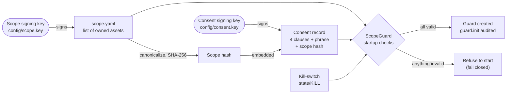

*Figure 5: The chain of trust. Changing a single character of the scope changes its hash and invalidates the old consent.*

**The four consent clauses [Implemented]**

1. `ownership` — I own, or am explicitly authorized to test, every asset in the scope.
2. `no_third_party` — I will not use this tool on third-party systems, and will not attack or retaliate (hack back).
3. `no_misuse_redistribution` — I will not modify the tool to remove its safeguards, nor redistribute it for misuse.
4. `legal_compliance` — I will comply with applicable laws (Japan's Unauthorized Computer Access Act and Penal Code, CFAA, CMA, StGB §202c, etc.).

The operator must also type the exact phrase `I OWN THESE ASSETS AND ACCEPT THE TERMS`.

---

## 6. ScopeGuard decision flow

`ScopeGuard.authorize(action, target, environment, approved)` checks the following **on every call**, in this order.
The outcome — allow or deny — is always written to the audit log.

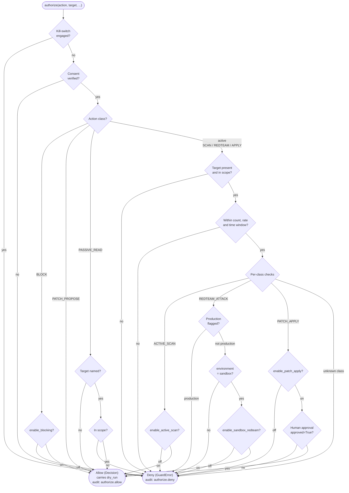

*Figure 6: ScopeGuard decision flow. Unknown classes are denied (fail closed). The "never production, sandbox only" rule for attack validation is checked before the toggle, so no setting can lift it.*

Even when an action is allowed, with `dry_run: true` (the default) modules **only return and record the commands they would run**; nothing is executed.

---

## 7. Tamper-evident audit log (hash chain) [Implemented]

`state/audit.jsonl` receives one record per line, shaped like this:

```json
{"seq": 42, "ts": "2026-10-18T03:21:07+00:00", "event": "authorize.deny",
 "data": {"action": "active_scan", "target": "198.51.100.7", "error": "ScopeViolation"},
 "prev": "9f2c... (hash of record 41)", "hash": "a71e... (hash of this record)"}
```

`hash` is the SHA-256 of the canonical JSON of `seq, ts, event, data, prev`.
Because each record contains the hash of the previous one, the records form a chain.

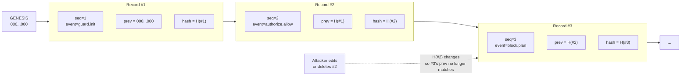

*Figure 7: The hash chain. Deleting, editing or reordering any record in the middle is detected by `sentinel verify`.*

`sentinel verify` and `sentinel report` recompute every record from the start, checking that `prev` matches, `seq` is consecutive and `hash` is correct.

> **Limitation (stated honestly):** a hash chain kept on a single machine cannot stop an attacker
> **who has gained root and rebuilds the whole log from scratch**. Preventing that is the job of
> cross-witnessing between nodes and external anchoring in Section 13.

---

## 8. Reproduction in an isolated sandbox [Implemented]

Validation with attack techniques (`REDTEAM_ATTACK`) is performed **only against a disposable, isolated copy (replica), never production**.

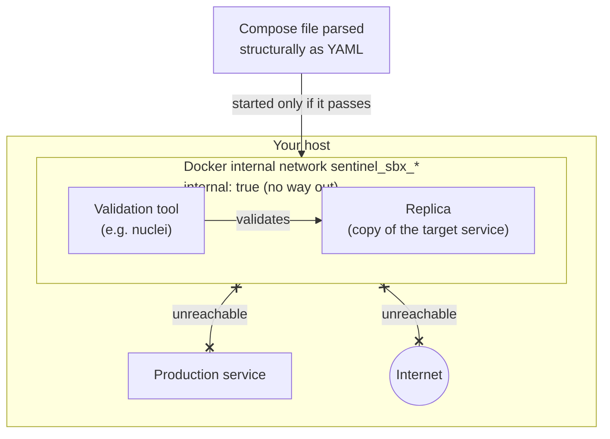

*Figure 8: Sandbox isolation. The replica and the validation tool are confined to an internal network with no exit; they can reach neither production nor the Internet.*

**Structural checks on the Compose file (parsed as YAML, not string-matched)**

If any of the following is found, start-up is refused — even in dry-run:

- attachment to a network that is not `internal: true`, or use of the default bridge
- `privileged: true`
- sharing host namespaces (`network_mode` / `pid` / `ipc` / `uts` / `userns_mode` set to `host`)
- `cap_add`, `devices`
- a `security_opt` that removes confinement (e.g. `unconfined`)
- binding the Docker socket or sensitive host paths
- publishing ports with `ports`

**Binding validation commands**

A validation command is refused unless it is bound to that sandbox's network or Compose project.
`--privileged`, `--net=host`, `--cap-add` and Docker-socket binds are refused too.
Bring-up, each validation and teardown are all audited, and teardown always runs even if a validation raises.

---

## 9. Patch proposal and conflict-evaluation loop [Implemented]

Finding a vulnerability is pointless if the fix takes production down.
So **a fix is first tried in the sandbox and refined until it is clean**, and only then shown to a human.

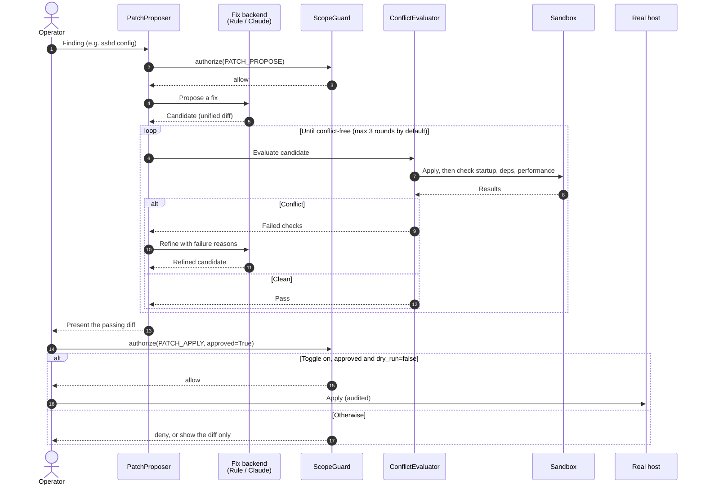

*Figure 9: The propose → evaluate → refine loop. A fix reaches a real host only when the toggle, human approval and dry_run=false all hold.*

- The fix backend is pluggable. The default is the offline `RuleBackend` (deterministic, easy to test).
  With `[agent]` installed, `AnthropicBackend` uses Claude and falls back to the rules on failure.
- **AI-generated fixes can be wrong.** That is exactly why conflict evaluation and human approval are mandatory.

---

## 10. Defensive blocking (no hack-back) [Implemented]

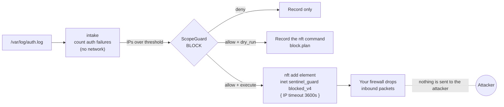

*Figure 10: Defensive blocking. Blocks expire automatically (TTL), and no traffic is ever sent back to the attacker.*

Retaliating against an attacker ("hack-back") can be illegal in many jurisdictions, including Japan, so it is **deliberately not built**.

---

## 11. AI usage governor [Implemented]

When AI (Claude) is used for fix proposals and the like, a daily token budget keeps usage from growing without bound.

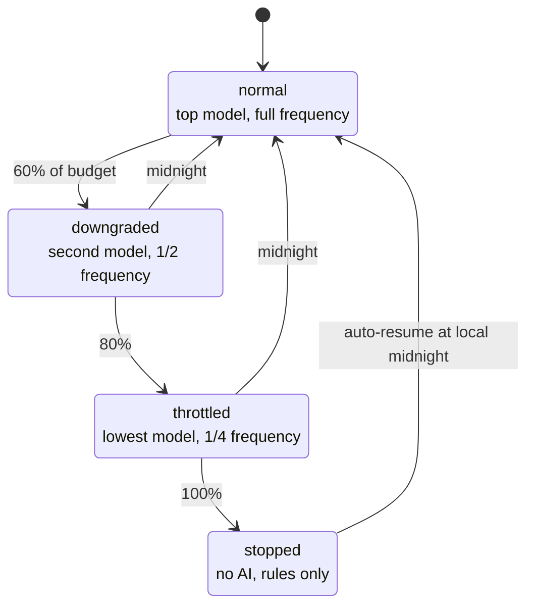

*Figure 11: Usage-governor states (thresholds configurable under `usage:` in `settings.yaml`). With a subscription provider (`provider: cli`) there is no token stop; only the frequency cap applies.*

---

## 12. Dashboard and control API [Implemented]

- `sentinel dashboard --once` — a plain-text snapshot with no extra dependencies
- `sentinel dashboard` — interactive TUI (needs `[tui]`): a world map with arrows from attacker countries to home,
  blocked (`x`), active (`!`) and home (`@`) markers, activity log, pending decisions, attack graph and a settings screen
- `sentinel config dump|get|set` and `sentinel state --json` — read and write every setting and the state as JSON from other apps

The dashboard only **reads** the audit log, so nothing on it can trigger an attack or a block.

---

## 13. Multi-PC cooperation and composite chain "BOGYO Mesh" (proposal)

> ⚠️ **This section is a design proposal. It is not in the current code.**
> Any implementation must respect every safety constraint listed here.

### 13.1 Goals

| Problem | Single-node limitation | BOGYO Mesh answer |
|---------|------------------------|----------------------|
| Record tampering | With root, an attacker can rebuild the whole log | Other nodes hold signed head hashes, so a rebuild is exposed |
| Slow detection | Each server learns about attackers on its own | An attacker detected by one node is shared, signed, with all nodes |
| Single point of failure | If the defending node stops, defense stops | Other nodes keep watching and detect the outage itself |
| Spreading a bad decision | — | One node's decision alone never propagates (k-of-n agreement required) |

### 13.2 Topology

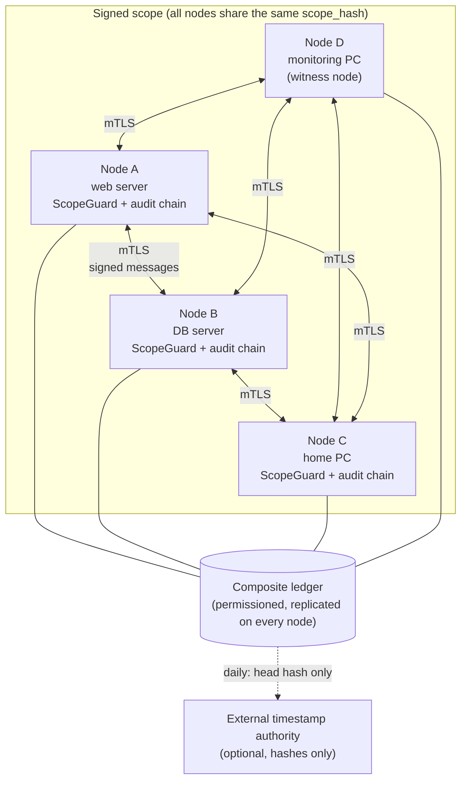

*Figure 12: Proposed BOGYO Mesh topology. Only your own assets listed in the signed scope may join. Only hash values leave the mesh — never log contents.*

**Membership requirements**

- The node's address is in the signed scope shared by all nodes.
- Each node's Ed25519 key is certified by the scope signing key (a node certificate).
- Communication uses mutual TLS (mTLS), and every message carries the sender node's signature.

### 13.3 Structure of the composite chain

"Combining blockchain techniques" means **stacking four tamper-resistance layers with different properties**:

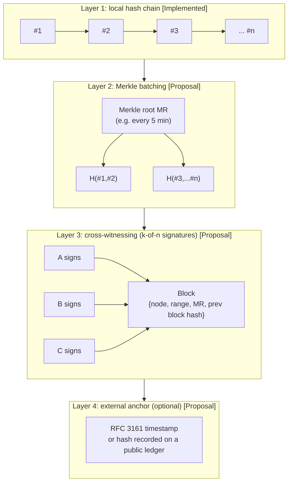

*Figure 13: The four-layer composite chain. Lower layers are fast and local; higher layers add stronger third-party assurance.*

| Layer | Prevents | Does not prevent (covered by the next layer) |
|-------|----------|----------------------------------------------|
| 1 Hash chain | Deleting, editing or reordering records in the middle | A full rebuild |
| 2 Merkle tree | — (efficient summaries of many records; inclusion proofs for single records) | A rebuild on a single node |
| 3 k-of-n cross-witnessing | Rebuilds by up to f compromised nodes (n ≥ 3f+1, k = 2f+1; e.g. 3 of 4 signatures tolerates one compromised node) | All nodes compromised at once |
| 4 External anchor | Rewriting the past after every node is compromised | Forging future records (detection is still possible from that point on) |

### 13.4 Sharing block decisions (signed and agreed)

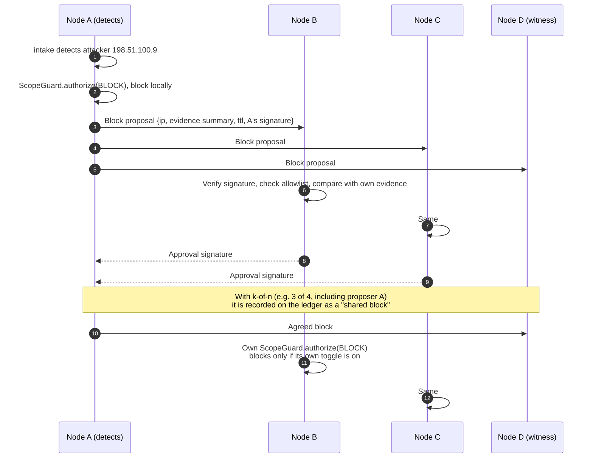

*Figure 14: Proposed block sharing. Information from other nodes is a "signed proposal", never a command; each node's own ScopeGuard makes the final decision.*

**Mandatory safety constraints for any implementation**

1. **Only "drop inbound traffic" blocks may be shared.** Never accept scan or attack-validation commands from another node.
2. **Every node's own ScopeGuard must be passed.** Even with agreement from other nodes, the local toggles, kill-switch and dry_run take precedence.
3. **Never block the allowlist** (your management IPs, monitoring IPs, upstream gateways) — this prevents a compromised node from locking you out.
4. **Every shared block has a TTL**, so a false positive heals itself over time.
5. **Kill-switch propagation.** If any node engages its kill-switch, the others stop accepting shared blocks. Conversely, a "release kill-switch" message from another node must never be accepted.
6. **Only hash values leave the mesh.** Log contents, IPs and settings are never sent to an external anchor.
7. **Out-of-scope nodes cannot join.** The mesh is a federation of your own assets and must never become a means of spreading into someone else's network.

### 13.5 Why permissioned?

| Approach | Consensus | Fit for BOGYO Mesh |
|----------|-----------|-----------------------|
| Public (e.g. Bitcoin) | Proof of Work | ✕ All participants are you; costly in power and latency |
| Public (PoS family) | Proof of Stake | ✕ No need for economic incentives |
| Permissioned BFT (e.g. PBFT) | 3f+1 nodes tolerate f faulty | ○ Better choice for larger node counts |
| Permissioned k-of-n signatures | A fixed number of signatures | ◎ Simplest and easiest to verify at a few nodes |

> **How many nodes and signatures?** If up to f nodes may be compromised, preventing conflicting records from both being
> finalized requires n ≥ 3f+1 nodes and k = 2f+1 signatures (the same bound as PBFT). **To tolerate one compromised node, use 3 of 4.**
> With 2 of 3, a single compromised node could sign both of two conflicting records.
> *Detecting* a rebuild, however, works with as few as two nodes, as long as an honest node holds the signed head hash.

---

## 14. Defense in depth, summarized

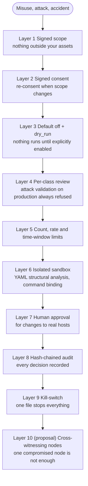

*Figure 15: Defense in depth. If one layer is breached, the next one stops it.*

---

## 15. Glossary

| Term | Meaning |
|------|---------|
| Fail-closed | A design that falls to "deny/stop" when something is wrong or information is missing |
| Scope | The list of assets you own or are authorized to test |
| Dry run (`dry_run`) | Show what would be done without doing it |
| Sandbox | A disposable environment isolated from production |
| Replica | A copy that reproduces a production service |
| Hash chain | A log in which each record contains the hash of the previous one, so tampering is detectable |
| Merkle tree | A tree of hashes that summarizes many data items into one value |
| k-of-n signatures | Valid only when at least k of n nodes have signed |
| Anchor | Fixing your ledger's hash in a trusted external record |
| Hack-back | Retaliating against an attacker; not done by this tool because it may be illegal |
| TTL | Time to live; blocks are lifted automatically when it expires |
| mTLS | TLS in which both sides authenticate each other with certificates |

---

Related: [Usage guide](02_usage-guide.md) / [Paper](03_paper.md) / [Requests for safe use](04_safe-use-requests.md) / [Disclaimer](05_disclaimer.md)
