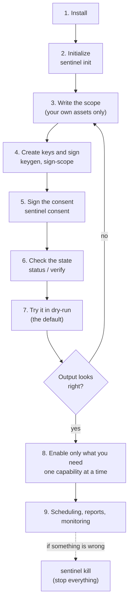
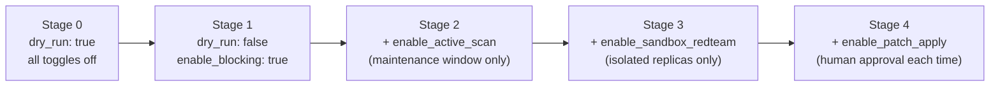

# BOGYO Usage Guide

> **Read this first:** this tool may be used **only on assets you own or are explicitly authorized in writing to test**.
> Before you start, read and agree to the [Requests for safe use](04_safe-use-requests.md) and the [Disclaimer](05_disclaimer.md).

Applies to: bogyo 0.1.0 / Platform: Linux, Python 3.11+

---

## 0. The overall flow



*Figure A: From installation to operation. Always start in dry-run.*

---

## 1. Install

```bash
git clone <this repository> bogyo
cd bogyo
python3 -m venv .venv && . .venv/bin/activate
pip install -e ".[dev]"            # core features and tests
pip install -e ".[agent]"          # (optional) LangGraph and Claude-based fix proposals
pip install -e ".[tui]"            # (optional) interactive dashboard
python -m pytest -q                # confirm all tests pass
```

External tools (only for the capabilities you use):

| Capability | Requires |
|------------|----------|
| Blocking (`block`) | `nftables` (`nft`) and root |
| Scanning (`scan`) | `nmap`, `nuclei` |
| Sandbox (`sandbox`) | Docker and Docker Compose |
| AI fix proposals | `ANTHROPIC_API_KEY` environment variable (with `[agent]`) |

---

## 2. Initialize

```bash
sentinel init --lang en
```

- creates `config/` and `state/`;
- creates the consent key pair (`config/consent.key` / `config/consent.pub`);
- writes `config/settings.yaml` (see the comments in `config/settings.example.yaml` for every option).

> 🔒 `config/*.key` are private keys. **Never share them or commit them to Git** (they are already in `.gitignore`).

---

## 3. Write the scope (the most important step)

```bash
cp config/scope.example.yaml config/scope.yaml
```

Edit `config/scope.yaml` and list **only assets you own or have written authorization to test**.

```yaml
owner_name: "Jane Doe"
owner_org: "Home lab"

allowed_hosts:          # hosts/IPs that may be targeted
  - "web01.home.internal"
  - "192.168.10.20"

allowed_cidrs:          # networks that may be targeted
  - "192.168.10.0/24"

production_hosts:       # production (attack validation is always refused here)
  - "web01.home.internal"

created_at: "2026-10-18"
nonce: "change-me-to-a-random-string"
```

**Guidance**

- ✅ Your own home servers, VPSs you rent yourself, test environments at work for which you have **written permission**
- ❌ Other people's servers, your employer's production without permission, a cloud provider's shared infrastructure, anything you merely think is "probably fine"
- For cloud/VPS hosts, also check **whether the provider's terms allow penetration testing**.
- Always list production in `production_hosts`; attack validation against it is then refused automatically.

---

## 4. Create keys and sign the scope

```bash
sentinel keygen          # creates config/scope.key (secret) and config/scope.pub
sentinel sign-scope      # creates config/scope.yaml.sig
```

Whenever you change the scope, run `sign-scope` again, then `consent` again (the scope hash changes).

---

## 5. Sign the consent

```bash
sentinel consent
```

Read each of the four clauses (ownership, no third parties, no misuse-oriented modification, legal compliance) and type `yes`.
Finally, type this phrase **exactly**:

```
I OWN THESE ASSETS AND ACCEPT THE TERMS
```

> The `--yes` option exists for CI and tests. Do not use it in real operation; read the clauses.

---

## 6. Check the state

```bash
sentinel status    # mode, toggles, limits, scope, consent, audit log, kill-switch
sentinel verify    # verifies scope signature, consent and audit chain (exit code 2 on failure)
```

You are ready when `status` shows:

```
dry_run: True
scope  : VERIFIED  hash=...
consent: VERIFIED
audit  : intact
kill   : clear
```

---

## 7. Try it in dry-run (the default state)

By default `dry_run: true` and every active capability is off.
In this state **nothing is executed; the commands that would run are only shown and recorded**.

```bash
# Detect brute-force sources in the auth log (shows the planned block commands)
sentinel block --from-logs /var/log/auth.log --threshold 5 --ttl 3600

# Show the scan plan for an in-scope host
sentinel scan 192.168.10.20 --tool nmap

# Produce a hardening diff (display only)
sentinel patch --service sshd --config /etc/ssh/sshd_config

# Build a report from the audit log
sentinel report --md run.md --json run.json
```

An out-of-scope target is refused like this (this is correct behavior):

```
REFUSED (ScopeViolation): target '198.51.100.7' is outside the signed scope
```

---

## 8. Enable capabilities one at a time

Review the dry-run output and, **only when it is what you intended**, enable the capabilities you need one by one.



*Figure B: An example of staged enablement. Run each stage for a few days and review the audit log and reports before moving on.*

```bash
sentinel config set dry_run false
sentinel config set toggles.enable_blocking true
sentinel config set limits.time_window "01:00-05:00"     # e.g. restrict scans to the night
sentinel status
```

### 8.1 Blocking (nftables)

Once, as root, create the table, sets and chain used for blocking (the commands are returned by `FirewallBlocker.ensure_table_commands()` in `src/sentinel/block/blocker.py`).
Blocks have a time to live (TTL) and are lifted automatically when it expires. **No retaliation is ever sent to the attacker.**

> ⚠️ Before enabling blocking, make sure you can log in by another route (e.g. a console) in case you accidentally block your own management IP.

### 8.2 Scanning

With `enable_active_scan: true`, only in-scope targets can be scanned.
Limits apply on count (`max_targets_per_run`), rate (`rate_per_minute`) and time window (`time_window`).

### 8.3 Reproduction in the sandbox

```bash
sentinel sandbox --replica 192.168.10.30 \
  --compose docker/sandbox.example.compose.yaml \
  --validate "nuclei=docker compose -p sentinel_sbx_192_168_10_30 exec -T web nuclei -u http://localhost"
```

- `--replica` must be a host ID that is **in scope and not flagged as production**.
- The Compose file is structurally checked as YAML and refused if it has a way out, privileges, host sharing or published ports.
- Validation commands are refused unless bound to that sandbox's network/project.

### 8.4 Applying a fix

```bash
sentinel patch --service sshd --config /etc/ssh/sshd_config \
  --host 192.168.10.20 --apply --approve
```

A fix is applied only when `enable_patch_apply: true`, `--approve` (human approval) and `dry_run: false` all hold.
**Always back up the configuration file before applying** (the current version makes no automatic backup).
Also note that in the current version, applying writes to **the file on this machine**; `--host` is used for the scope check and the audit record.

---

## 9. Scheduling, reports and monitoring

### 9.1 Scheduling

```bash
sentinel schedule --command "block --from-logs /var/log/auth.log" --on-calendar daily
```

This **only prints** a systemd service/timer and a cron entry. Review them, then install them yourself.
Scheduling attack validation (sandbox) is deliberately refused.

### 9.2 Reports

```bash
sentinel report --md report.md --json report.json
```

Summarizes allow/deny counts, blocks, applied changes and whether the audit chain is intact.

### 9.3 Dashboard

```bash
sentinel dashboard --once     # plain-text snapshot
sentinel dashboard            # interactive TUI (press 'c' for settings)
sentinel state --json         # state as JSON for other apps
```

### 9.4 AI usage

```bash
sentinel usage
```

---

## 10. Emergency stop

```bash
sentinel kill --reason "investigating a false positive"    # stop everything now
sentinel status                                             # confirm kill : ENGAGED
sentinel resume                                             # resume after finding the cause
```

The kill-switch is the file `state/KILL`. While it exists, both guard creation and every operation are refused.

---

## 11. Troubleshooting

| Message | Meaning | What to do |
|---------|---------|------------|
| `REFUSED (ScopeViolation)` | Target is out of scope | Re-check the target. If it really is yours, add it to scope.yaml, re-sign and re-consent |
| `REFUSED (ConsentRequired)` | No consent, or no re-consent after a scope change | `sentinel consent` |
| `REFUSED (ModeViolation)` | Toggle off, attack validation on production, no approval, etc. | Check settings and target. Attack validation on production cannot be enabled |
| `REFUSED (LimitExceeded)` | Count, rate or time-window limit | Wait, or review the limits |
| `REFUSED (KillSwitchEngaged)` | Kill-switch is engaged | Find the cause, then `sentinel resume` |
| `audit chain TAMPERED` | The audit log has been altered or corrupted | **Suspect an intrusion.** Preserve the log and investigate the host |

> If tampering is detected, do not delete the log; preserve it as-is and consult experts or law enforcement as needed.

---

## 12. About multi-PC cooperation

"BOGYO Mesh", which links several PCs together, is **a proposal and not implemented yet** ([Concept and Architecture, Section 13](01_concept-and-architecture.md#13-multi-pc-cooperation-and-composite-chain-sentinel-mesh-proposal)).
To protect several machines today, **install BOGYO on each machine separately and sign, consent and operate on each one**.
Collecting `sentinel report --json` from each machine gives you an overall picture.

---

Related: [Concept and Architecture](01_concept-and-architecture.md) / [Paper](03_paper.md) / [Requests for safe use](04_safe-use-requests.md) / [Disclaimer](05_disclaimer.md)
