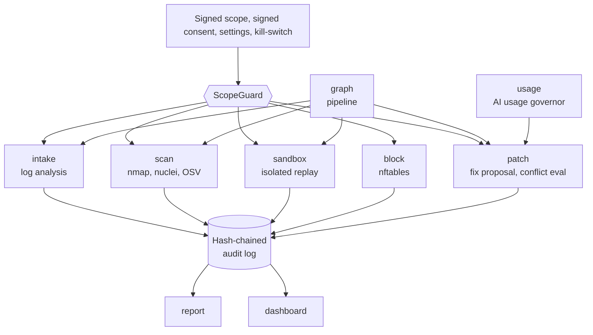
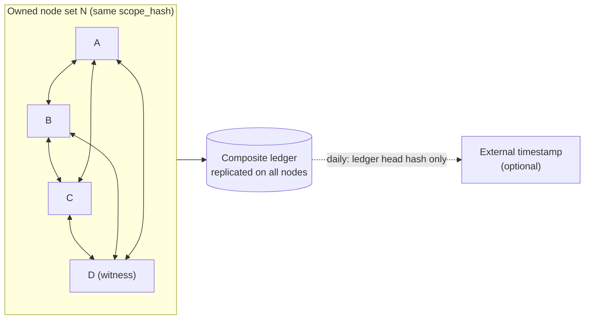

# Consent-Gated Proactive Self-Defense and a Layered Tamper-Evident Ledger against AI-Accelerated Attacks

## Design, Implementation and Evaluation of BOGYO, with a Proposal for Multi-Node "BOGYO Mesh"

Author: BOGYO contributors / Version: preprint draft v0.1 (2026-10-18) / Implementation: bogyo 0.1.0 (2026-10-18 snapshot)

> **Snapshot note:** these documents describe the BOGYO 0.1.0 code as of 2026-10-18. Since then the multi-node mesh has been **implemented** (rolling-key channel, signed patch chain, and a sandbox conflict gate before apply) — see [../WHITEPAPER.md](../WHITEPAPER.md) §4 and [../MESH_SETUP.md](../MESH_SETUP.md). Statements below that call the mesh a proposal or "not implemented" are out of date.

> **Scope of the claims in this paper:** the capabilities and measurements in Sections 5 and 8 are implemented in the repository to be published and can be checked against its tests.
> The multi-node "BOGYO Mesh" in Section 6 is a **proposal (not implemented)**; its security is argued at the design level only.

---

## Abstract

Generative AI is automating and accelerating offensive work such as turning advisories into exploits, large-scale reconnaissance and generating malware variants, shrinking the window between a vulnerability's disclosure and its exploitation. Defense built around manual periodic checks and after-the-fact response cannot keep up with this difference in speed. Yet when defenders automate assessment and attack validation, a dual-use problem appears: misdirected, the tool itself becomes a means of attacking third parties.

We propose BOGYO, a design that satisfies both requirements at once: the speed to find and close one's own weaknesses before attackers do, and the safety never to act on anything other than one's own assets. At its center is ScopeGuard, a single authorization gate through which every active operation passes. It combines an Ed25519-signed scope of owned assets, an operator's signed consent bound to that scope's hash, default-deny toggles, an unconditional refusal of attack validation against production, human approval for applying changes, a kill-switch and a hash-chained audit log, and always falls to the deny side when anything is wrong (fail-closed). Attack validation runs only inside disposable Docker sandboxes whose isolation is enforced by structural YAML analysis, and fix proposals are shown to a human only after a conflict-evaluation loop in the sandbox.

The implementation consists of about 4,200 lines of Python and 85 tests, with a test mapped to every safety property. Guard decisions take a median of 44–109 µs and audit appends about 29 µs per entry, so they never become the bottleneck of the automated defense loop. The single-node audit chain detected all 200 trials each of modification, deletion and reordering of records. We also confirm experimentally that a full rewrite by an attacker who has obtained write access cannot be detected on a single node, and show that an externally held head hash does detect it. To remove this limitation we propose "BOGYO Mesh", a permissioned composite ledger in which several PCs owned by the operator mutually attest the heads of their audit chains with Merkle trees and k-of-n signatures, optionally anchored to external timestamps, and discuss its safety conditions.

**Keywords**: proactive defense, self-assessment, fail-closed, dual-use, consent gate, tamper-evident logging, hash chain, Merkle tree, permissioned blockchain, Byzantine fault tolerance, AI-assisted attacks

---

## 1. Introduction

### 1.1 Motivation

Attackers can now use AI to assemble attack procedures from public information in a short time and repeat attempts against many targets. For defenders this is a matter of **time**. During the period a vulnerability exists, the longer the defender's inspection interval, the more likely it is that the attacker finds the vulnerability first. Defenders therefore need to inspect their own assets frequently and automatically.

Automated inspection and validation tools, however, inherently have the same capabilities as attack tools. A scanner can be pointed at someone else's server, and attack validation can take a production service down. The further defense is automated, the greater the risk that **misuse, misconfiguration or compromise turns the defender's tool into an attacker's tool**. This tension is the starting point of our work.

### 1.2 The author's defense philosophy

This work rests on three ideas of the author:

1. **Get there first**: find the vulnerabilities in your own servers before hackers do, and defend them.
2. **Redundancy and cooperation**: link multiple PCs so they watch each other, so that breaking one does not bring down the whole.
3. **Tamper-evident records**: protect defensive records and decisions by combining the techniques that underpin blockchains (hash chains, digital signatures, Merkle trees, distributed agreement).

All three sit on a foundation of safety: never act on anything other than your own assets.

### 1.3 Contributions

- **C1** We formulate design principles that reconcile automated proactive defense with the containment of dual-use risk (fail-closed, single gate, default deny, production inviolability, human approval, no retaliation, complete recording, immediate stop) (Section 4).
- **C2** We build BOGYO implementing these principles and map each safety property to tests (Sections 5 and 8).
- **C3** We show experimentally both the detection capability and the limitation of a single-node hash-chained audit log (Section 8).
- **C4** We propose BOGYO Mesh, a permissioned composite ledger among owned nodes that addresses this limitation, and discuss its safety conditions under node compromise (Sections 6 and 7).

---

## 2. Background and related work

### 2.1 Automation of attack and defense with AI

Automated vulnerability discovery and repair with AI is advancing on the defensive side through research and competitions (e.g. the DARPA AI Cyber Challenge [22]). The same capabilities are available to attackers, and speed has become a competitive axis for both. Our work focuses on **safety brakes** for automating defense, complementing work that aims to improve detection and repair capabilities themselves.

### 2.2 Practical guidance for security assessment

NIST SP 800-115 [13] gives guidance for planning, conducting and reporting technical security tests and calls for a clear scope and authorization. NIST CSF 2.0 [14] adds "Govern" to Identify, Protect, Detect, Respond and Recover. BOGYO can be seen as an attempt to implement this guidance mechanically, by **enforcing scope and authorization cryptographically** and by making the governance record tamper-evident.

### 2.3 Intrusion prevention and automatic blocking

Detecting attackers from logs and blocking them at the firewall, as typified by fail2ban [18], is widely practiced. BOGYO's blocking follows this lineage but places blocking under the authorization gate and audit log, makes blocks time-limited (TTL) and excludes retaliation against the attacker by design.

### 2.4 Tamper-evident logs and timestamps

Haber and Stornetta [1] showed how to make timestamps hard to forge by chaining document hashes. Schneier and Kelsey [4] proposed secure audit logs that protect past entries even on a compromised machine, and Ma and Tsudik [25] used forward-secure aggregate signatures. Crosby and Wallach [5] built efficient tamper-evident logs from Merkle-tree-based history trees. Certificate Transparency [11] operates append-only Merkle-tree logs at scale, verified by multiple monitors. RFC 3161 [10] defines time attestation by a third-party timestamp authority. BOGYO's first layer (the hash chain) is the simplest form of [1][4]; layers 2–4 of the proposed BOGYO Mesh apply the ideas of [5][10][11] to mutual attestation among owned nodes.

### 2.5 Blockchains and distributed agreement

Bitcoin [3] realized a ledger among unidentified participants using hash-chained blocks and Proof of Work consensus. Where participants are known, permissioned agreement such as PBFT [7], addressing the Byzantine Generals Problem [6], and permissioned blockchains such as Hyperledger Fabric [24] are used. Since BOGYO Mesh participants are limited to the operator's own nodes, Proof of Work is unnecessary and permissioned k-of-n signature agreement is appropriate.

### 2.6 Classic safety-design principles

Saltzer and Schroeder [12] set out principles including fail-safe defaults, complete mediation and least privilege. ScopeGuard implements **complete mediation** of every active operation and **fail-safe defaults** through default deny.

---

## 3. Threat model

### 3.1 Assets

Linux servers owned by the operator (or for which written test authorization exists), the services on them, and the defense system's own decisions and records.

### 3.2 Threats considered

| ID | Threat | Example |
|----|--------|---------|
| T1 | Intrusion by external attackers | AI-assisted reconnaissance and exploits against public services; brute-force logins |
| T2 | Misdirection of the defense tool | Operator typo, coercion or faulty automation acting on third parties |
| T3 | Silent expansion of authority | Tampering with scope, consent or settings to widen targets |
| T4 | Accidents in production | Attack validation or fix application taking production down |
| T5 | Erasing tracks | Deleting, altering or rebuilding the audit log after intrusion |
| T6 | Derivatives with safeguards removed | Forks or redistributions that strip the guard |
| T7 | Runaway automation | Excessive scheduled runs; unbounded AI usage |
| T8 | Compromise of a cooperating node (Section 6) | A compromised node emitting false blocks or false records |

### 3.3 Trust assumptions

- The operator's private keys (`config/*.key`) are kept secret.
- The OS of the host running the guard and the Docker daemon are trustworthy, at least at decision time.
- The cryptographic primitives (SHA-256, Ed25519 [8][9]) are secure.

### 3.4 Out of scope

Retaliation against third parties (hack-back), development of new exploit code, generic attack payloads and detection evasion are illegal or dangerous and are **not built** by design.

---

## 4. Design principles

| Principle | Content | Threats addressed |
|-----------|---------|-------------------|
| P1 Single gate (complete mediation) | Every active operation is authorized by ScopeGuard; no flag disables the guard | T2, T3, T6 |
| P2 Signed scope | Targets are limited to the signed scope | T2, T3 |
| P3 Bound consent | Consent is bound to the scope hash and lapses when the scope changes | T3 |
| P4 Default deny and dry-run | All active capabilities are disabled by default; `dry_run` is enabled by default | T2, T4 |
| P5 Production inviolability | Attack validation is unconditionally refused on production and allowed only in a sandbox | T4 |
| P6 Human approval | Applying changes to a real host requires explicit human approval | T4 |
| P7 No retaliation | Defense is limited to dropping inbound traffic | T2 (legal risk) |
| P8 Complete recording | Every allow, deny and execution is recorded tamper-evidently | T5 |
| P9 Immediate stop and limits | Kill-switch; count, rate and time-window limits; AI usage governance | T7 |
| P10 Multiple attestation (proposal) | Several owned nodes attest each other's records | T5, T8 |

---

## 5. System design and implementation

### 5.1 Overview



*Figure 1: Structure of BOGYO. Each capability acts only through the guard and writes its result to the audit log. Reports and the dashboard are pure readers of the audit log.*

The implementation targets Python 3.11+, with only three required dependencies: `pydantic`, `pyyaml` and `cryptography`. LangGraph and the Anthropic SDK (`[agent]`) and Textual (`[tui]`) are loaded lazily, so the core and its tests run offline.

### 5.2 Formalizing scope and consent

Let the scope be S = (H, C, P), where H is the set of allowed hosts, C the set of allowed CIDRs and P the production subset. A target t is in scope when

  in(t, S) ⇔ t ∈ H ∨ ∃c ∈ C: t ∈ c.

From the canonical representation canon(S) (UTF-8 JSON with sorted keys and minimal separators) we compute the scope hash h_S = SHA-256(canon(S)) and the scope signature σ_S = Sign(sk_scope, canon(S)).

A consent record R consists of the operator name, h_S, the set of accepted clauses, the confirmation phrase, the tool version, a time and a nonce, signed as σ_R = Sign(sk_consent, canon(R)). The guard is created at start-up only if all of

  Verify(pk_scope, canon(S), σ_S) ∧ Verify(pk_consent, canon(R), σ_R) ∧ R.h = h_S ∧ R.clauses ⊇ Clauses ∧ R.phrase = Phrase ∧ ¬Kill

hold. Changing even one byte of the scope changes h_S and makes R.h = h_S false, so **any expansion of the scope always requires re-consent**.

### 5.3 The authorization function

Let the guard's authorization function be authorize(a, t, e, ap) → {Allow(dry_run), Deny(reason)}, where a is the action class, t the target, e the environment and ap human approval. There are six action classes:

| Class | Target must be in scope | Toggle | Extra conditions |
|-------|:---:|--------|------------------|
| PASSIVE_READ | only if t is given | — | — |
| PATCH_PROPOSE | — | — | — |
| BLOCK | — | enable_blocking | inbound drop only |
| ACTIVE_SCAN | required | enable_active_scan | within limits |
| REDTEAM_ATTACK | required | enable_sandbox_redteam | t ∉ P ∧ e = sandbox |
| PATCH_APPLY | required | enable_patch_apply | ap = true |

Checks run in the order kill-switch → consent → per-class rules → scope → limits → toggles and extra conditions. For REDTEAM_ATTACK, the checks t ∉ P and e = sandbox come **before** the toggle and cannot be lifted by configuration. Unknown classes are denied. Every call, whatever its outcome, writes exactly one record to the audit log. BLOCK does not require its target to be in scope, since the target is the attacker's (someone else's) IP, but its effect is confined to the local host's firewall.

### 5.4 Hash-chained audit log

For the i-th record e_i = (seq_i, ts_i, ev_i, d_i, prev_i, h_i):

  h_0 = 0^256,  prev_i = h_{i−1},  h_i = SHA-256(canon(seq_i, ts_i, ev_i, d_i, prev_i)).

Verification checks from the start that prev matches, seq is consecutive and h recomputes correctly. Appends use file append mode, and the file mode is set to 0640.

### 5.5 Isolated sandbox

Attack validation is performed only against disposable replicas on a dedicated Docker network created with `--internal` (no egress). The Compose file is parsed **structurally as YAML** rather than string-matched, and is refused — even in dry-run — if it contains any of: attachment to a non-internal network or the default bridge, `privileged`, shared host namespaces, `cap_add`, `devices`, a `security_opt` that removes confinement, a bind of the Docker socket or sensitive host paths, or published `ports`. Validation commands are refused unless bound to that sandbox's network or Compose project; `--privileged`, `--net=host`, `--cap-add` and socket binds are refused too. Teardown always runs, even if an exception occurs.

### 5.6 Fix proposal and conflict-evaluation loop

Fix generation uses a pluggable backend: a deterministic rule-based backend by default (offline), and optionally generation with Claude (falling back to rules on failure). Candidates are applied in the sandbox, checked for startup, dependency and performance regressions, and refined with the failed checks attached (at most 3 rounds by default). Only applying to a real host requires PATCH_APPLY, and only when the toggle, explicit approval and dry_run=false all hold. Starting from the premise that **AI-generated fixes can be wrong**, the structure makes it impossible to skip conflict evaluation and human approval.

### 5.7 Defensive blocking

Sources whose authentication failures exceed a threshold are extracted from failed-authentication logs (with no network access) and added with a timeout to an nftables dynamic set. Blocking only drops inbound packets and sends nothing to the attacker.

### 5.8 Operational control and visibility

- **Scheduling**: a systemd timer and cron entry are printed but never installed automatically. Scheduling commands that include attack validation is refused.
- **AI usage governor**: as the daily token budget is consumed, it downgrades the model and halves frequency at 60%, switches to the lowest model at a quarter of the frequency at 80%, stops at 100%, and resumes automatically at the next local midnight (thresholds configurable).
- **Reports and dashboard**: reports and the world-map dashboard are generated only from the audit log and explicitly show chain breakage.

---

## 6. Proposal: multi-node cooperation and the composite ledger "BOGYO Mesh" (not implemented)

### 6.1 Motivation

A single-node hash chain detects modification, deletion and reordering of records in the middle, but cannot detect an attacker with write access **rebuilding the whole chain** (demonstrated in Section 8.3). Detection requires a head hash held somewhere the attacker cannot rewrite. We therefore link several PCs owned by the operator so that they attest each other's head hashes.

### 6.2 Structure

Let N be the set of nodes (|N| = n). Each node v has a ScopeGuard, a local audit chain and a node key (sk_v, pk_v). A node certificate cert_v = Sign(sk_scope, (v, pk_v, h_S)) ensures that **only nodes belonging to the same signed scope** can join. Nodes communicate over mutual TLS [23], and every message carries the sender's signature.



*Figure 2: Structure of BOGYO Mesh. Only hash values leave the mesh; log contents never do.*

### 6.3 Four-layer structure of the composite ledger

1. **Layer 1, local chain** (implemented): Section 5.4.
2. **Layer 2, Merkle batching**: at fixed intervals (e.g. every 5 minutes) each node computes the Merkle root MR over the record hashes in a range [i_s, i_e] [2][5].
3. **Layer 3, mutual attestation**: a block B_j = (v, [i_s, i_e], MR_j, h_{i_e}, H(B_{j−1})) is sent to the other nodes; each checks continuity with the previous block it holds and signs. A block with signatures from k distinct nodes is final.
4. **Layer 4, external anchoring (optional)**: the head hash of the finalized block sequence is periodically recorded with an RFC 3161 [10] timestamp authority or on a public ledger.

### 6.4 Conditions for agreement

Let f be the number of compromised nodes. For two conflicting blocks for the same range never to both become final, the intersection of any two quorums of size k must contain at least one honest node, giving

  2k − n ≥ f + 1.

For honest nodes alone to be able to finalize (liveness), n − f ≥ k is required. Together these give n ≥ 3f + 1 and k = 2f + 1, matching the classic PBFT bound [7]. For example, **tolerating one compromised node requires n = 4, k = 3**. With n = 3 and k = 2, a single compromised node may sign both of two conflicting blocks. For **detection** alone, however, a rebuild is exposed with fewer nodes, as long as an honest node holds the signed head.

### 6.5 Sharing blocks

When node v detects attacker x, it authorizes BLOCK with its own guard and blocks locally, then sends a signed block proposal (x, evidence summary, ttl). Other nodes check the signature, the allowlist and their own evidence and return approval signatures. A shared block finalized with k signatures is applied **only if each node's own guard authorizes BLOCK again**.

### 6.6 Safety constraints (mandatory for any implementation)

| ID | Constraint | Reason |
|----|------------|--------|
| M1 | The only operation that may be shared is BLOCK | Other nodes must never trigger scans or attack validation |
| M2 | Each node's own guard always makes the final decision | Toggles, dry-run and the kill-switch take precedence |
| M3 | The allowlist is never blocked | Prevents a compromised node from locking the operator out |
| M4 | Every shared block has a TTL | Bounds the impact of false positives in time |
| M5 | The kill-switch propagates only in the stopping direction | Other nodes cannot release a stop |
| M6 | Only hash values go outside | Log contents, IPs and settings never leave |
| M7 | Membership is limited to owned nodes in the same scope | The mesh must not become a means of spreading into others' networks |

---

## 7. Safety analysis

### 7.1 Safety properties

| Property | Content | Evidence |
|----------|---------|----------|
| S1 Scope soundness | An active class is allowed only if in(t, S) | §5.3; tests `test_out_of_scope_target_refused` and others |
| S2 Production inviolability | REDTEAM_ATTACK is allowed only if t ∉ P ∧ e = sandbox (independent of toggles) | §5.3; `test_redteam_on_production_hard_refused`, `test_redteam_requires_sandbox_environment` |
| S3 Default deny | With default settings BLOCK, ACTIVE_SCAN, REDTEAM and APPLY are all denied | `test_active_scan_requires_toggle`, `test_block_requires_toggle`, `test_redteam_requires_toggle` |
| S4 Human approval | Allowing PATCH_APPLY requires ap = true | `test_patch_apply_requires_approval` |
| S5 Bound consent | After a scope change, no guard can be created until re-consent | `test_scope_change_invalidates_consent`, `test_tampered_consent_signature_refused` |
| S6 Complete recording | Each authorize call appends exactly one audit record | Implementation structure in §5.3 |
| S7 Tamper detection | Modification, deletion or reordering of record i (i < n) is detected by verification | `test_audit_chain_detects_tampering`; §8.3 |
| S8 Stoppability | With the kill-switch engaged, guard creation and every operation are denied | `test_killswitch_blocks_construction` |
| S9 Isolation | Compose files and validation commands that violate isolation are refused | `tests/test_sandbox.py` (28 tests) |

### 7.2 Mapping to threats

- **T2/T3 (misdirection, expansion of authority)**: S1 and S5 prevent action outside the scope and silent expansion of the scope. Expanding the scope itself requires the operator's private key and re-consent.
- **T4 (production accidents)**: S2, S3, S4 and dry-run make attack validation against production impossible and limit application to human-approved changes.
- **T5 (erasing tracks)**: S7 detects partial tampering. A full rebuild cannot be detected on a single node and is covered by layers 3 and 4 of BOGYO Mesh (Section 6).
- **T6 (derivatives with safeguards removed)**: this cannot be prevented technically. Concentrating the guard in a single path with no disable flag means removal requires explicit source modification; the Terms of Use prohibit it, and mapping safety properties to tests makes a weakening change fail the test suite.
- **T7 (runaway automation)**: contained by limits, time windows, the AI usage governor and the kill-switch.
- **T8 (node compromise, proposal)**: the quorum condition of §6.4 and constraints M1–M7 of §6.6 prevent finalization of false records and lock-out through false blocks.

---

## 8. Evaluation

### 8.1 Environment

Measurements were taken in a container with x86_64, 4 vCPUs (Intel Xeon 2.10 GHz) and Python 3.13.16. The measurement script is `docs/publication/eval/bench_audit_guard.py` and the results are in `docs/publication/eval/results-2026-10-18.json`. Numbers vary with the file system and CPU state, so orders of magnitude, not absolute values, are what matter.

### 8.2 Functional tests

There are 85 tests in 12 files, all passing.

| Test file | Count | Main checks |
|-----------|------:|-------------|
| test_sandbox.py | 28 | Structural Compose analysis, refusal of escape hatches, binding of validation commands, guaranteed teardown |
| test_guard.py | 13 | Scope, toggles, production inviolability, approval, kill-switch, count limit |
| test_patch.py | 8 | Fix generation, conflict-evaluation loop, apply gate |
| test_control.py | 7 | Control API, i18n, offline IP-to-country mapping |
| test_consent_scope.py | 4 | Consent binding, refusal of tampered signatures |
| test_audit_intake_block.py | 4 | Chain tamper detection, log analysis, blocking in dry-run |
| test_dashboard.py | 4 | Dashboard model |
| test_graph.py | 4 | Pipeline and skipping on refusal |
| test_usage.py | 4 | Governor level transitions |
| test_llm_usage.py | 3 | Feeding real token counts into the governor |
| test_report.py | 3 | Reports from the audit log; explicit chain breakage |
| test_schedule.py | 3 | Schedule generation; refusal of attack validation |
| **Total** | **85** | |

### 8.3 Tamper detection in the audit chain

We created 10,000 records and applied each of three kinds of tampering 200 times at randomly chosen positions.

| Tampering | Trials | Detected |
|-----------|-------:|---------:|
| Modifying a record's content | 200 | 200 |
| Deleting a record | 200 | 200 |
| Swapping adjacent records | 200 | 200 |

Next, assuming an attacker with write access, we removed the 4 records about a particular IP out of 1,000 and **re-chained the rest from scratch**. This forged chain **passed local verification**. It did not, however, match the head hash held externally before the tampering, and **was detected by the externally held head hash**. This supports the need for the mutual attestation and external anchoring of Section 6.

### 8.4 Performance

| Item | Result |
|------|--------|
| Audit append | about 29 µs per record |
| Audit verification (10,000 records) | about 0.1 s |
| Guard decision (allow, including audit append) | median about 71 µs |
| Guard decision (deny, out of scope) | median about 44 µs |
| Guard decision (deny, attack validation on production) | median about 109 µs |

All are in the microsecond to hundred-millisecond range, negligible compared with network scanning (seconds to minutes) or sandbox start-up (seconds). In other words, **imposing a safety gate on every operation barely affects the speed of the automated defense loop**.

### 8.5 Limitations of the evaluation

The evaluation is limited to unit tests and micro-benchmarks; long-term operation in production, detection rates against real attacks, fix quality and operator usability were not evaluated. BOGYO Mesh is not implemented, and the discussion in Section 6 is at the design level.

---

## 9. Discussion

### 9.1 Can speed and safety coexist?

The central question of this work is whether defense can be automated further without losing safety. The results in §8.4 show that the computational cost of the safety gate does not hurt the speed of automation. The real cost of safety is not computation but **the operator's effort in signing, consenting and enabling capabilities in stages**. The author regards this effort as the "confirmation of intent" that handling a dual-use tool requires.

### 9.2 Why not retaliate?

The source of an attack is often a third party whose machine has been used as a stepping stone, so retaliation can harm uninvolved people. It may also be illegal in many jurisdictions. Limiting defense to dropping inbound traffic is the safest choice both technically and legally.

### 9.3 Caution in using AI for defense

The system optionally uses AI to generate fixes. Because AI output can be wrong, its impact is limited by four means: (1) fallback to deterministic rules, (2) conflict evaluation in the sandbox, (3) human approval, and (4) the usage governor. AI is positioned to **make proposals, not to make decisions**.

### 9.4 Limitations

- On a single node, a complete rebuild of the audit log by an attacker who has gained root cannot be detected (§8.3).
- In the current version, applying a fix writes a local file and makes no automatic backup.
- Sandbox isolation depends on the security of Docker and the host kernel.
- Derivatives with safeguards removed cannot be prevented technically (only deterred by terms, design and tests).
- IP-to-country estimation can be inaccurate; the displayed country of an attacker does not indicate the attacker's real location.

---

## 10. Ethical and legal considerations

The system assumes use only on assets owned by the operator or for which written test authorization exists, and enforces that assumption technically through the signed scope and consent. In Japan the relevant laws include the Act on the Prohibition of Unauthorized Computer Access [19] and the Penal Code provisions on unauthorized command electromagnetic records and on obstruction of business by damaging computers [20]; internationally, the Convention on Cybercrime [21] and national laws based on it (the US CFAA, the UK Computer Misuse Act, German StGB §202c, etc.). The system contains no new exploit code or generic attack payloads; it controls widely used legitimate tools for defense and authorized self-assessment. This paper is not legal advice. For publication and use, see the [Requests for safe use](04_safe-use-requests.md) and the [Disclaimer](05_disclaimer.md).

---

## 11. Future work

1. Implementing BOGYO Mesh (node certificates, mTLS, Merkle batching, k-of-n signatures, block sharing, external anchoring) and evaluating it under node compromise.
2. Forward-secure key evolution [4][25] to protect records written before a compromise.
3. Automatic backup and rollback when applying fixes.
4. A safe application path for remote hosts.
5. Long-term evaluation in real environments and evaluation of operator usability.
6. Formal verification of the guard's decision logic.

---

## 12. Conclusion

In an era when AI accelerates attacks, defenders too must inspect their own assets frequently and automatically and close weaknesses before attackers find them. Automated inspection tools are dual-use, however, and become instruments of harm when misused. We designed and implemented BOGYO, which concentrates a signed scope, bound consent, default deny, production inviolability, human approval, complete recording and immediate stop in a single authorization gate; showed experimentally that the gate does not slow automation; and demonstrated both the detection capability and the limitation of a single-node audit chain. We further proposed BOGYO Mesh, a permissioned composite ledger among owned nodes that addresses this limitation. **Speed and safety can be reconciled by design** — that is the claim of this work.

---

## References

1. S. Haber and W. S. Stornetta, "How to Time-Stamp a Digital Document," *Journal of Cryptology*, vol. 3, no. 2, pp. 99–111, 1991.
2. R. C. Merkle, "A Digital Signature Based on a Conventional Encryption Function," in *Advances in Cryptology — CRYPTO '87*, LNCS 293, Springer, 1988.
3. S. Nakamoto, "Bitcoin: A Peer-to-Peer Electronic Cash System," 2008.
4. B. Schneier and J. Kelsey, "Secure Audit Logs to Support Computer Forensics," *ACM Transactions on Information and System Security*, vol. 2, no. 2, pp. 159–176, 1999.
5. S. A. Crosby and D. S. Wallach, "Efficient Data Structures for Tamper-Evident Logging," in *Proc. 18th USENIX Security Symposium*, 2009.
6. L. Lamport, R. Shostak, and M. Pease, "The Byzantine Generals Problem," *ACM Transactions on Programming Languages and Systems*, vol. 4, no. 3, pp. 382–401, 1982.
7. M. Castro and B. Liskov, "Practical Byzantine Fault Tolerance," in *Proc. 3rd USENIX Symposium on Operating Systems Design and Implementation (OSDI)*, 1999.
8. D. J. Bernstein, N. Duif, T. Lange, P. Schwabe, and B.-Y. Yang, "High-speed high-security signatures," *Journal of Cryptographic Engineering*, vol. 2, no. 2, pp. 77–89, 2012.
9. S. Josefsson and I. Liusvaara, "Edwards-Curve Digital Signature Algorithm (EdDSA)," RFC 8032, 2017.
10. C. Adams, P. Cain, D. Pinkas, and R. Zuccherato, "Internet X.509 Public Key Infrastructure Time-Stamp Protocol (TSP)," RFC 3161, 2001.
11. B. Laurie, A. Langley, and E. Kasper, "Certificate Transparency," RFC 6962, 2013.
12. J. H. Saltzer and M. D. Schroeder, "The Protection of Information in Computer Systems," *Proceedings of the IEEE*, vol. 63, no. 9, pp. 1278–1308, 1975.
13. K. Scarfone, M. Souppaya, A. Cody, and A. Orebaugh, "Technical Guide to Information Security Testing and Assessment," NIST Special Publication 800-115, 2008.
14. National Institute of Standards and Technology, "The NIST Cybersecurity Framework (CSF) 2.0," NIST CSWP 29, 2024.
15. The MITRE Corporation, "MITRE ATT&CK," https://attack.mitre.org/
16. Cybersecurity and Infrastructure Security Agency (CISA), "Known Exploited Vulnerabilities Catalog," https://www.cisa.gov/known-exploited-vulnerabilities-catalog
17. OSV — Open Source Vulnerabilities, https://osv.dev/
18. fail2ban, https://github.com/fail2ban/fail2ban
19. Act on the Prohibition of Unauthorized Computer Access (Act No. 128 of 1999), Japan.
20. Penal Code (Act No. 45 of 1907), Articles 168-2, 168-3 and 234-2, Japan.
21. Council of Europe, "Convention on Cybercrime," ETS No. 185, 2001.
22. Defense Advanced Research Projects Agency (DARPA), "AI Cyber Challenge (AIxCC)," https://aicyberchallenge.com/
23. E. Rescorla, "The Transport Layer Security (TLS) Protocol Version 1.3," RFC 8446, 2018.
24. E. Androulaki et al., "Hyperledger Fabric: A Distributed Operating System for Permissioned Blockchains," in *Proc. EuroSys*, 2018.
25. D. Ma and G. Tsudik, "A New Approach to Secure Logging," *ACM Transactions on Storage*, vol. 5, no. 1, 2009.

> Before publication, re-check every bibliographic detail (volume, issue, pages, URL) against the original sources.

---

## Appendix A. Notation

| Symbol | Meaning |
|--------|---------|
| S = (H, C, P) | Scope (allowed hosts, allowed CIDRs, production subset) |
| h_S | Canonical hash of the scope |
| σ_S, σ_R | Scope signature, consent signature |
| a, t, e, ap | Action class, target, environment, human approval |
| h_i | Hash of the i-th audit record |
| MR | Merkle root |
| n, k, f | Number of nodes, signatures needed to finalize, compromised nodes |

## Appendix B. Reproduction

```bash
python3 -m venv .venv && . .venv/bin/activate
pip install -e ".[dev]"
python -m pytest -q                                  # 85 passed
python docs/publication/eval/bench_audit_guard.py    # measurements of §8.3–8.4
```

## Appendix C. Terms of use for this paper

Use of this paper and the accompanying software is subject to the [Requests for safe use](04_safe-use-requests.md) and the [Disclaimer](05_disclaimer.md).
